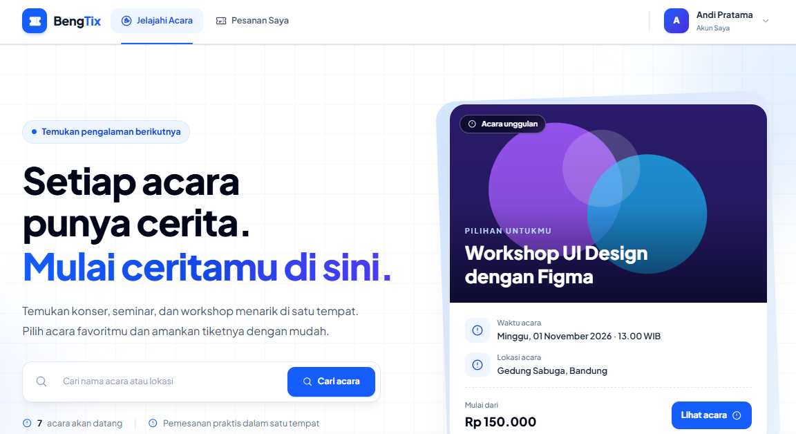
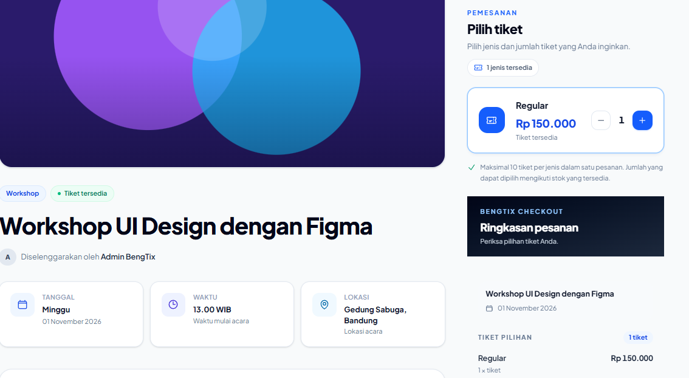
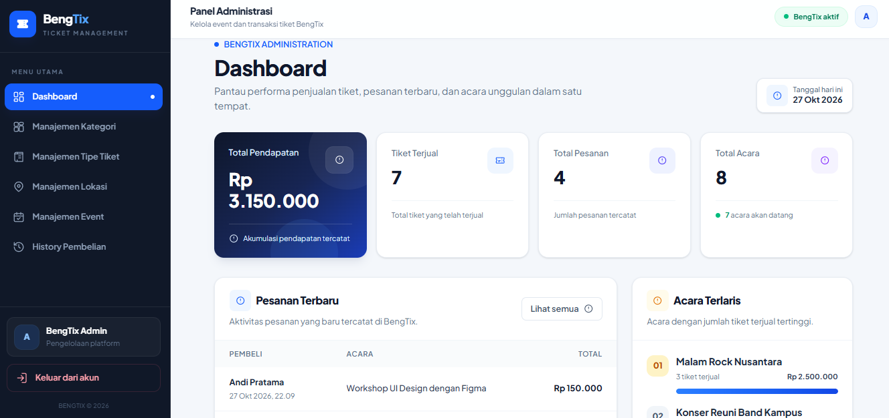

# BengTix — Sistem Manajemen dan Pemesanan Tiket Event

BengTix adalah aplikasi web untuk menjelajahi acara, melihat informasi dan pilihan tiket, serta mengelola pemesanan secara terpusat. Sistem ini dikembangkan menggunakan Laravel dengan antarmuka yang responsif dan desain modern untuk memberikan pengalaman yang nyaman bagi pengguna maupun administrator.

## 📸 Preview Aplikasi

### Halaman Utama

Menampilkan halaman utama BengTix sebagai platform pemesanan tiket acara.



### Detail Acara dan Pemilihan Tiket

Menampilkan informasi acara, pilihan tiket, dan ringkasan pesanan sebelum melakukan pemesanan.



### Dashboard Admin

Menampilkan dashboard administrasi untuk membantu pengelolaan dan pemantauan sistem BengTix.



## ✨ Fitur Utama

### Pengguna

- **Jelajahi acara:** melihat daftar acara berdasarkan jadwal, kategori, dan lokasi.
- **Pencarian dan filter:** mencari acara berdasarkan judul atau lokasi, menyaring kategori dan lokasi, serta mengurutkan daftar acara.
- **Detail acara:** melihat deskripsi, poster, waktu, lokasi, dan pilihan tiket yang tersedia.
- **Pemesanan tiket:** memilih jenis dan jumlah tiket serta melihat total harga pesanan.
- **Riwayat pesanan:** melihat informasi transaksi dan detail pesanan.
- **Autentikasi pengguna:** registrasi, login, dan pengelolaan profil akun.

### Administrator

- **Dashboard administrasi:** menyediakan akses ke pengelolaan data sistem.
- **Manajemen acara:** mengelola informasi acara, jadwal, kategori, lokasi, dan poster.
- **Manajemen tiket:** mengatur jenis tiket, harga, dan stok.
- **Manajemen kategori dan lokasi:** mengelola data pendukung acara.
- **Manajemen pesanan:** memantau informasi pesanan dan detail transaksi.

## 🛠️ Teknologi

| Teknologi                | Penggunaan                                  |
| ------------------------ | ------------------------------------------- |
| PHP                      | Bahasa pemrograman backend                  |
| Laravel                  | Framework aplikasi web                      |
| Blade                    | Template antarmuka                          |
| MySQL                    | Basis data relasional                       |
| Tailwind CSS             | Styling dan layout responsif                |
| DaisyUI                  | Komponen antarmuka berbasis Tailwind CSS    |
| JavaScript dan Alpine.js | Interaksi antarmuka                         |
| Vite                     | Pengelolaan aset frontend                   |
| Python                   | Pembuatan poster SVG untuk data demonstrasi |

## 🎨 Desain Antarmuka

BengTix menggunakan pendekatan desain modern dengan warna utama Midnight Navy dan Electric Blue, dipadukan dengan latar terang, tipografi yang jelas, kartu acara, serta komponen antarmuka yang responsif.

Poster acara disimpan di direktori publik aplikasi. Proyek juga menyediakan poster SVG untuk data demonstrasi melalui script Python.

## 🚀 Instalasi dan Menjalankan Aplikasi

### Persyaratan

Pastikan perangkat telah memiliki:

- PHP dan Composer yang sesuai dengan versi Laravel pada proyek.
- MySQL atau MariaDB.
- Node.js dan npm.
- Git.

### 1. Clone repository

```bash
git clone https://github.com/Hariss1011/Sistem-Manajemen-Tiket.git
cd Sistem-Manajemen-Tiket
```

### 2. Instal dependensi backend

```bash
composer install
```

### 3. Instal dependensi frontend

```bash
npm install
```

### 4. Konfigurasi environment

Salin file konfigurasi contoh:

```bash
copy .env.example .env
```

Buat application key:

```bash
php artisan key:generate
```

Sesuaikan konfigurasi database di file `.env` dengan MySQL lokal yang digunakan:

```dotenv
DB_CONNECTION=mysql
DB_HOST=127.0.0.1
DB_PORT=3306
DB_DATABASE=ticketing_app
DB_USERNAME=root
DB_PASSWORD=
```

Sesuaikan nama database, username, dan password dengan konfigurasi lokal.

### 5. Siapkan database

Pastikan database `ticketing_app` telah dibuat, kemudian jalankan:

```bash
php artisan migrate --seed
```

Perintah tersebut menjalankan migrasi dan mengisi database dengan data demonstrasi melalui seeder.

**Perhatian:** `php artisan migrate:fresh --seed` akan menghapus seluruh tabel dan data yang ada sebelum membuat ulang database. Gunakan hanya pada lingkungan pengembangan ketika data lama memang boleh dihapus.

### 6. Buat poster demonstrasi

Jika ingin membuat ulang poster SVG yang digunakan oleh data demonstrasi, jalankan script Python dari direktori utama proyek:

```bash
python python3_buat_poster.py
```

### 7. Jalankan aplikasi

Buka terminal pertama:

```bash
php artisan serve
```

Buka terminal kedua:

```bash
npm run dev
```

Akses aplikasi melalui:

http://127.0.0.1:8000

## 🗂️ Struktur Proyek

```text
app/
├── Http/
│   ├── Controllers/
│   └── Middleware/
└── Models/

database/
├── migrations/
└── seeders/

public/
└── images/
    └── events/

resources/
├── css/
├── js/
└── views/

routes/
├── web.php
└── auth.php

python3_buat_poster.py
```

Struktur di atas merupakan gambaran direktori utama yang relevan dengan aplikasi.

## 🧪 Data Demonstrasi

Seeder menyediakan data awal untuk membantu pengujian fitur acara, kategori, lokasi, jenis tiket, pengguna, dan pemesanan.

Akun demonstrasi yang dibuat oleh seeder:

| Peran         | Email              | Password   |
| ------------- | ------------------ | ---------- |
| Administrator | `admin@gmail.com`  | `password` |
| Pengguna      | `andi@example.com` | `password` |

Gunakan akun tersebut hanya untuk lingkungan lokal. Ganti kredensial sebelum aplikasi digunakan di lingkungan publik.

## 🎯 Tujuan Pengembangan

Proyek BengTix dikembangkan sebagai portofolio untuk menerapkan konsep pengembangan aplikasi web menggunakan Laravel, pengelolaan basis data relasional, autentikasi dan otorisasi, pengolahan data acara dan tiket, alur pemesanan, serta perancangan antarmuka pengguna yang responsif.

## 👨‍💻 Repository

Source code: [Hariss1011/Sistem-Manajemen-Tiket](https://github.com/Hariss1011/Sistem-Manajemen-Tiket)
